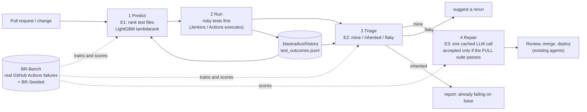
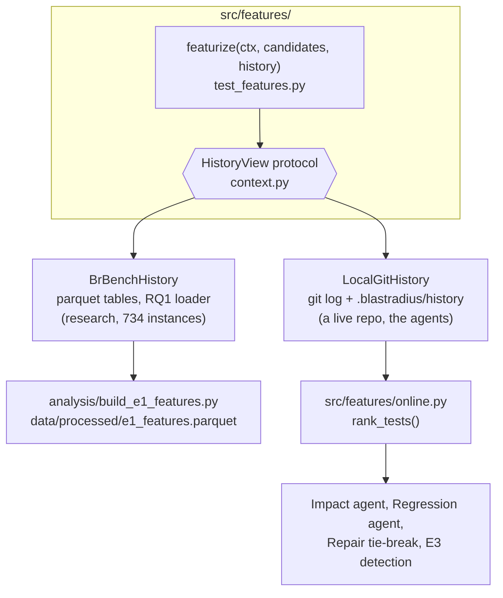

# BlastRadius 2.0: architecture

BlastRadius 2.0 turns the BR-Bench dataset into a change-aware CI assistant with four stages. All of them are
trained and scored on BR-Bench (the seeded benchmark covers the repair stage). Decisions: D-56..D-59 in
`docs/DECISIONS.md`.

## 1. The four stages and the feedback loop

| stage | experiment | what it decides | model | LLM? |
|---|---|---|---|---|
| Predict | E1 (`analysis/rq2_predictor.py`) | which test files will fail | LightGBM lambdarank, `models/e1_lgbm_v1.txt` | no |
| Run | existing Regression agent | executes selected tests in ranked order, then the rest | (CI server) | no |
| Triage | E2 (`analysis/rq3_triage.py`) | for each failure: mine / inherited / flaky | LightGBM binary, `models/e2_triage_v1.txt` | no |
| Repair | E3 (`analysis/rq4_repair.py`) | a patch for failures that are mine | one LLM call (Groq free tier), cached, replayable | **only here** |

Only `src/agents/repair.py` (through `src/agents/llm.py`) calls a language model (D-58). The model is a replaceable component, not
the architecture: the retrieval that decides what it sees, and the acceptance rule that decides whether its answer is kept, are
deterministic.

## 2. The shared feature layer (offline and online are the same code)

`featurize` never reads a parquet or a git repository itself; it asks a `HistoryView`. Every method of that view takes the prediction
time `ts` and may only return information strictly before it, so time-safety is a property of the interface, and
`analysis/leakage_audit.py` re-derives a sample of cells from raw rows to prove it (0 violations in the audit at the commit
that generated `paper/generated/leakage_audit.md`).

Feature families (`hist_`, `cochg_`, `cofail_`, `prox_`, `chg_`, optional `graph_`) are defined in
`src/features/test_features.py`; the ablation drops one family at a time.

## 3. Agent mapping (D-55 plus 2.0)

| agent | module | 2.0 change |
|---|---|---|
| Impact Analysis | `src/agents/impact.py` | tests ranked by the E1 model (`ranker: e1-lgbm-v1`), each with its three largest SHAP contributions; the keyword + reachability heuristic decides membership and remains the fallback |
| Coding | `src/agents/coding.py` | unchanged |
| Regression Suite | `src/agents/regression.py` | runs selected files in ranked order; reports `first_failure_position`; history now carries messages and branch |
| **Triage** | `src/agents/triage.py` | new; E2 model, rules R-branch / R-msg as fallback |
| **Repair** | `src/agents/repair.py` | new; arms R0-R3, strict SEARCH/REPLACE, full-suite acceptance |
| PR Reviewer | `src/agents/review.py` | unchanged; now sees a PR that has already been tested and, if needed, repaired |
| Build & Deploy | `src/agents/deploy.py` | unchanged |

The 2.0 order (`python -m src.agents pipeline`, `src/agents/flow.py`) is impact, code, **regress, triage, repair (at most two
attempts)**, review, deploy, with the existing notification when a failure cannot be repaired. `--stages classic` restores the
original five-agent order.

## 4. Why not just Jenkins?

Jenkins is the executor, and in every experiment it is the baseline row:

| question | what a CI server does | baseline row in the experiments |
|---|---|---|
| which tests first? | all tests, in file order | **B0 retest-all** (E1) |
| whose failure is it? | every failure is "yours" | **Blame-all** (E2) |
| what now? | notify the team | **R0 notify-only** (E3) |

BlastRadius does not replace the server and does not gate merges on predicted risk (a project non-goal). It supplies the three
answers a CI server does not: what to run first, why it failed, and a verified fix. `integrations/` shows how the same CLI plugs
into a Jenkinsfile and a GitHub Actions workflow; those files are examples, not deployments.

## 5. Determinism and provenance

- Reported runs: LightGBM `deterministic=True`, `force_row_wise=True`, `num_threads=1`, seed 0 (seeds 0-4 for the table).
- `make tables` has no network and no LLM (`BR_OFFLINE=1`); E1 and E2 are inside it, E3 is not (`make repair-eval` replays cached
  replies with the network forbidden).
- Every LLM request and reply is stored under `eval/llm_cache/` keyed by a hash of provider, model, prompt and sampling
  parameters; a cache miss in replay mode is an error.
